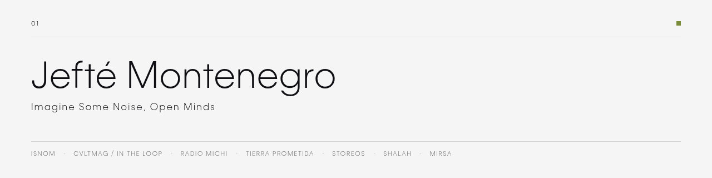

<picture>
  <source media="(prefers-color-scheme: dark)" srcset="assets/banner-dark.png 1x, assets/banner-dark@2x.png 2x">
  <source media="(prefers-color-scheme: light)" srcset="assets/banner.png 1x, assets/banner@2x.png 2x">
  
</picture>

# Jefté Montenegro

**Imagine Some Noise, Open Minds**

Fundador de [Grupo ISNOM](https://isnom.org). Diseño y construyo software, sistemas y medios independientes desde la Ciudad de México.

## Ahora

**[Grupo ISNOM](https://isnom.org)**  
Laboratorio creativo de tecnología y diseño. Desarrollo de software, SaaS e IA, hardware empresarial, infraestructura y soporte técnico.

**[cvltmag](https://cvltmag.net)**  
Medio independiente. Publica el boletín diario [In the Loop](https://cvltmag.net/newsletter).

**[Radio Michi](https://radiomichi.net)**  
Podcast de humor absurdo y sarcástico sobre noticias de México. Lo escribo y conduzco con Matsuo Sin Mats y Ray “Ukumi” García.

**[Tierra Prometida](https://tierraprometida.net)**  
Sitio de estudio bíblico. También desarrollo una app de Biblia en Swift/SwiftUI y un cliente de escritorio en Rust.

## Productos

**Shalah** — [send.isnom.org](https://send.isnom.org)  
Plataforma self-hosted para enviar archivos de forma segura. sendOS, por ISNOM Studios. El nombre viene del hebreo שָׁלַח (*shalach*): enviar, despachar, poner algo en camino.

**storeOS**  
Sistema de cotizaciones y ventas de Grupo ISNOM.

**MIRSA** — [mirsa.isnom.org](https://mirsa.isnom.org)

**[isnomCMS](https://github.com/jeftezmont/isnomCMS)**  
CMS propio, ligero y minimalista, con el que publico en [jeftezmont.me](https://jeftezmont.me).

## Archivo

**[.AuroraBorealis](https://github.com/jeftezmont/.AuroraBorealis)** — Inteligencia artificial de algoritmos genéticos, en Processing.

**[.isnomBOT](https://github.com/jeftezmont/.isnomBOT)** — Bot de Discord para la familia de servidores de ISNOM y RedStorm.

**[RSWW3](https://github.com/jeftezmont/RSWW3)** — Servidor de RedStorm inspirado en una hipotética Tercera Guerra Mundial.

## Contacto

[jeftezmont.me](https://jeftezmont.me)
· [Instagram](https://instagram.com/jeftezmont)
· [cvltmag](https://instagram.com/cvltmag)
